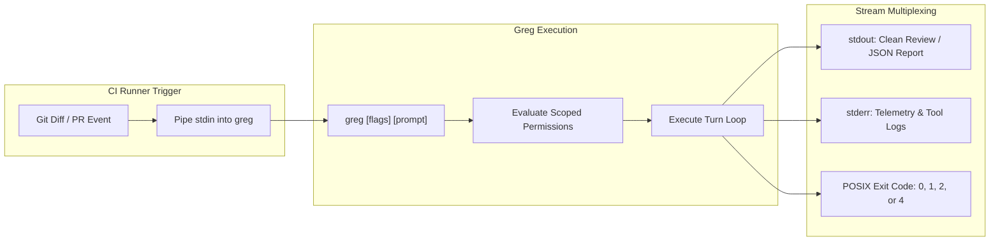

Because `greg` is engineered as a **print agent** conforming to the Unix philosophy—reading from `stdin`, streaming results to `stdout`, isolating diagnostic logs to `stderr`, and returning standard POSIX exit codes—it fits into automated headless pipelines, CI/CD runners, and pre-commit hooks.

Unlike interactive coding assistants that stall waiting for terminal prompts, `greg` executes autonomously from command-line flags and exits deterministically.

<Note>
Before running `greg` in automated pipelines, review [Permissions & Safety](/permissions) to configure appropriate tool access, and [Managing Providers](/model-providers) for setting API credentials in CI environments.
</Note>

This page covers:

- [Headless Execution Principles](#headless-execution-principles): Stream isolation, non-interactive mode, and fail-closed security.
- [POSIX Process Exit Codes](#posix-process-exit-codes): Scripting against exit codes (`0`, `1`, `2`, `4`) in CI automation.
- [Structured JSON Outputs](#structured-json-outputs): Parsing results with `jq` via `--output-format json` and `--output-format stream-json`.
- [Ephemeral CI Execution](#ephemeral-ci-execution): Preventing disk bloat on ephemeral runners.
- [Enforcing Output Schemas](#enforcing-output-schemas): Guaranteeing valid JSON data structures.
- [GitHub Actions Workflows](#github-actions-workflows): Production recipes for PR review, automated bug fixing, and security audits.
- [Pre-Commit Hooks](#pre-commit-hooks): Auditing staged Git diffs locally before commits.
- [Docker Containerization](#docker-containerization): Packaging `greg` in minimal containerized runners.
- [Next Steps](#next-steps): Guided links to deeper topics.

---

## Headless Execution Principles

When executing inside CI runners (like GitHub Actions, GitLab CI, or Jenkins), `greg` operates with zero interactive prompts:



1. **Non-Interactive by Design**: `greg` never waits for user keyboard input. If an unauthorized tool execution is attempted, `greg` fails closed immediately without hanging.
2. **Stream Separation**: Only final answers and structured payloads are sent to `stdout`. Progress indicators, tool notices, and warnings are isolated on `stderr`, ensuring pipeline steps (`| jq`, `| gh pr comment`) receive valid data.
3. **Automated Error Recovery**: Built-in request retries (`--max-retries`) and model fallback chains (`--fallback-model`) ensure transient provider rate limits do not break CI builds.

---

## POSIX Process Exit Codes

`greg` returns deterministic exit codes so automation scripts can make branching decisions:

| Exit Code | Constant           | Meaning                                                       | Recommended CI Action                          |
| :-------: | :----------------- | :------------------------------------------------------------ | :--------------------------------------------- |
|  **`0`**  | `success`          | Agent execution completed successfully.                       | Proceed to subsequent pipeline stages.         |
|  **`1`**  | `runtimeError`     | Runtime error, model failure, or uncaught exception.          | Fail the CI job and log diagnostics.           |
|  **`2`**  | `permissionDenied` | Operation aborted because an unauthorized tool was requested. | Fail the CI job or notify security team.       |
|  **`4`**  | `timeout`          | Wall-clock execution exceeded `--timeout` limit.              | Retry with higher timeout or reasoning budget. |

### Robust Shell Script Handling Recipe

```bash
#!/usr/bin/env bash
set -euo pipefail

echo "==> Running automated code review..."

EXIT_CODE=0
greg "Audit git diff origin/main for security issues and performance regressions." \
  --model anthropic/claude-sonnet-4-6 \
  --timeout 120s \
  --output-format json > review-output.json || EXIT_CODE=$?

if [ "$EXIT_CODE" -eq 0 ]; then
  echo "Audit passed cleanly."
elif [ "$EXIT_CODE" -eq 2 ]; then
  echo "Audit failed: Unauthorized tool execution attempted." >&2
  exit 2
elif [ "$EXIT_CODE" -eq 4 ]; then
  echo "Audit timed out after 120 seconds." >&2
  exit 4
else
  echo "Audit encountered runtime error (exit code: $EXIT_CODE)." >&2
  exit "$EXIT_CODE"
fi
```

---

## Structured JSON Outputs

For machine-to-machine integrations, avoid parsing raw Markdown text. Use `--output-format json` to receive a structured JSON payload:

```bash
greg "Analyze package.json and list all production dependencies requiring security updates" \
  --output-format json > report.json
```

The emitted JSON payload includes:

- `result`: The final model output text or parsed object.
- `sessionId`: The unique thread identifier.
- `turnMetrics`: Turn count, duration in milliseconds, and finish reason.
- `totalUsage`: Input, output, reasoning, and total token counts.

You can inspect findings directly with `jq`:

```bash
cat report.json | jq -r '.result'
cat report.json | jq '.totalUsage'
```

### Real-Time Event Streaming (`stream-json`)

For CI dashboards or live event telemetry, pass `--output-format stream-json`. `greg` emits newline-delimited JSON events for every token chunk, tool start, tool completion, and token step in real time.

---

## Ephemeral CI Execution

By default, `greg` creates thread directories and delta checkpoints under `~/.greg/threads/`. On ephemeral CI runners where disks are wiped after each job, this overhead is unnecessary.

Pass `--no-session-persistence` to run completely in-memory:

```bash
greg "Review diff" --no-session-persistence
```

When active:

- No session JSON files are created on disk.
- Pre-mutation snapshots are skipped.
- Disk I/O is reduced to zero.

---

## Enforcing Output Schemas

When downstream automation scripts expect an exact JSON schema, enforce structure using `--json-schema`:

```bash
SCHEMA='{
  "type": "object",
  "properties": {
    "passed": { "type": "boolean" },
    "severity": { "type": "string", "enum": ["low", "medium", "high", "critical"] },
    "summary": { "type": "string" },
    "issues": {
      "type": "array",
      "items": {
        "type": "object",
        "properties": {
          "file": { "type": "string" },
          "line": { "type": "number" },
          "description": { "type": "string" }
        },
        "required": ["file", "description"]
      }
    }
  },
  "required": ["passed", "severity", "summary", "issues"]
}'

greg "Audit git diff origin/main" \
  --json-schema "$SCHEMA" \
  --output-format json | jq '.result'
```

---

## GitHub Actions Workflows

### 1. Automated Pull Request Code Reviewer

Runs on every pull request, analyzes the diff against the target branch, and posts a review comment directly onto the PR:

```yaml
name: Greg Automated PR Review

on:
  pull_request:
    types: [opened, synchronize]

jobs:
  review:
    runs-on: ubuntu-latest
    permissions:
      contents: read
      pull-requests: write

    steps:
      - name: Checkout code
        uses: actions/checkout@v4
        with:
          fetch-depth: 0

      - name: Install Greg
        run: |
          curl -fsSL https://raw.githubusercontent.com/amaranthic/greg/main/installer/install.sh | bash
          echo "$HOME/.greg/bin" >> $GITHUB_PATH

      - name: Run Code Review
        env:
          ANTHROPIC_API_KEY: ${{ secrets.ANTHROPIC_API_KEY }}
          GH_TOKEN: ${{ secrets.GITHUB_TOKEN }}
        run: |
          # Ingest staged diff against base branch
          git diff origin/${{ github.base_ref }}...HEAD | greg \
            "Review this pull request diff for security vulnerabilities, race conditions, edge-case bugs, and performance regressions. Format findings with clear Markdown headers and actionable recommendations." \
            --model anthropic/claude-sonnet-4-6 \
            --timeout 180s \
            --no-session-persistence > pr-review.md

          # Post review comment to GitHub PR
          gh pr comment ${{ github.event.pull_request.number }} --body-file pr-review.md
```

---

### 2. Autonomous Bug Fixer & Test Verification

Fixes failing tests and automatically submits a pull request with the solution:

```yaml
name: Greg Auto-Fix CI Regressions

on:
  workflow_dispatch:
    inputs:
      test_file:
        description: "Test file to fix (e.g. tests/auth.test.ts)"
        required: true
        default: "tests/auth.test.ts"

jobs:
  autofix:
    runs-on: ubuntu-latest
    permissions:
      contents: write
      pull-requests: write

    steps:
      - name: Checkout repository
        uses: actions/checkout@v4

      - name: Setup Bun runtime
        uses: oven-sh/setup-bun@v2

      - name: Install dependencies
        run: bun install

      - name: Install Greg
        run: |
          curl -fsSL https://raw.githubusercontent.com/amaranthic/greg/main/installer/install.sh | bash
          echo "$HOME/.greg/bin" >> $GITHUB_PATH

      - name: Run Autonomous Fix
        env:
          ANTHROPIC_API_KEY: ${{ secrets.ANTHROPIC_API_KEY }}
        run: |
          # Create dedicated fix branch
          git checkout -b autofix/test-regressions

          # Authorize file edits and scoped test runner execution
          greg "Diagnose why ${{ github.event.inputs.test_file }} is failing, edit the codebase to fix the root cause, and verify all tests pass." \
            --permission-mode acceptEdits \
            --allowed-tools "Bash(bun test ${{ github.event.inputs.test_file }})" \
            --model anthropic/claude-sonnet-4-6 \
            --timeout 300s

      - name: Commit & Create Pull Request
        env:
          GH_TOKEN: ${{ secrets.GITHUB_TOKEN }}
        run: |
          git config user.name "greg-bot"
          git config user.email "greg-bot@users.noreply.github.com"
          git commit -am "fix(tests): resolve failing assertions in ${{ github.event.inputs.test_file }}"
          git push origin autofix/test-regressions
          gh pr create \
            --title "fix(tests): automated fix for ${{ github.event.inputs.test_file }}" \
            --body "Automated test regression fix generated by greg."
```

---

## Pre-Commit Hooks

Audit uncommitted changes before pushing to remote repositories using standard Git hooks or Husky:

### Setting Up a Git Pre-Commit Hook

Create `.git/hooks/pre-commit` (or configure via Husky):

```bash
#!/usr/bin/env bash
set -e

# Inspect staged changes for secrets or debugging artifacts
STAGED_DIFF=$(git diff --cached)

if [ -z "$STAGED_DIFF" ]; then
  exit 0
fi

echo "==> Auditing staged changes with greg..."

if ! echo "$STAGED_DIFF" | greg \
  "Audit these staged changes strictly for hardcoded API keys, secrets, console.log debugging statements, or syntax errors. If any are found, explain the problem and exit with an error. Otherwise reply 'OK'." \
  --timeout 30s \
  --no-session-persistence; then
  echo "Commit rejected: safety audit failed." >&2
  exit 1
fi
```

Make the script executable:

```bash
chmod +x .git/hooks/pre-commit
```

---

## Docker Containerization

To run `greg` inside containerized CI runners or Kubernetes jobs:

### Minimal Dockerfile

```dockerfile
FROM oven/bun:1.2-alpine

# Install curl, bash, git
RUN apk add --no-cache curl bash git openssh-client

# Install greg standalone binary
RUN curl -fsSL https://raw.githubusercontent.com/amaranthic/greg/main/installer/install.sh | bash -s -- --no-modify-path
ENV PATH="/root/.greg/bin:${PATH}"

WORKDIR /workspace

# Verify installation
RUN greg --version

ENTRYPOINT ["greg"]
```

### Running the Container

```bash
docker run --rm -v $(pwd):/workspace \
  -e ANTHROPIC_API_KEY="sk-ant-..." \
  greg:latest "Audit src/ for potential memory leaks" --no-session-persistence
```

---

## Next Steps

Now that you know how to automate `greg` in continuous integration:

- [Permissions & Safety](/permissions): Harden tool authorization with fail-closed rules.
- [Lifecycle Hooks](/hooks): Build event-driven pre-commit and post-execution guardrails.
- [Common Workflows](/common-workflows): Explore everyday terminal developer recipes.
- [Managing Providers](/model-providers): Configure fallback chains and custom proxy gateways for CI.
