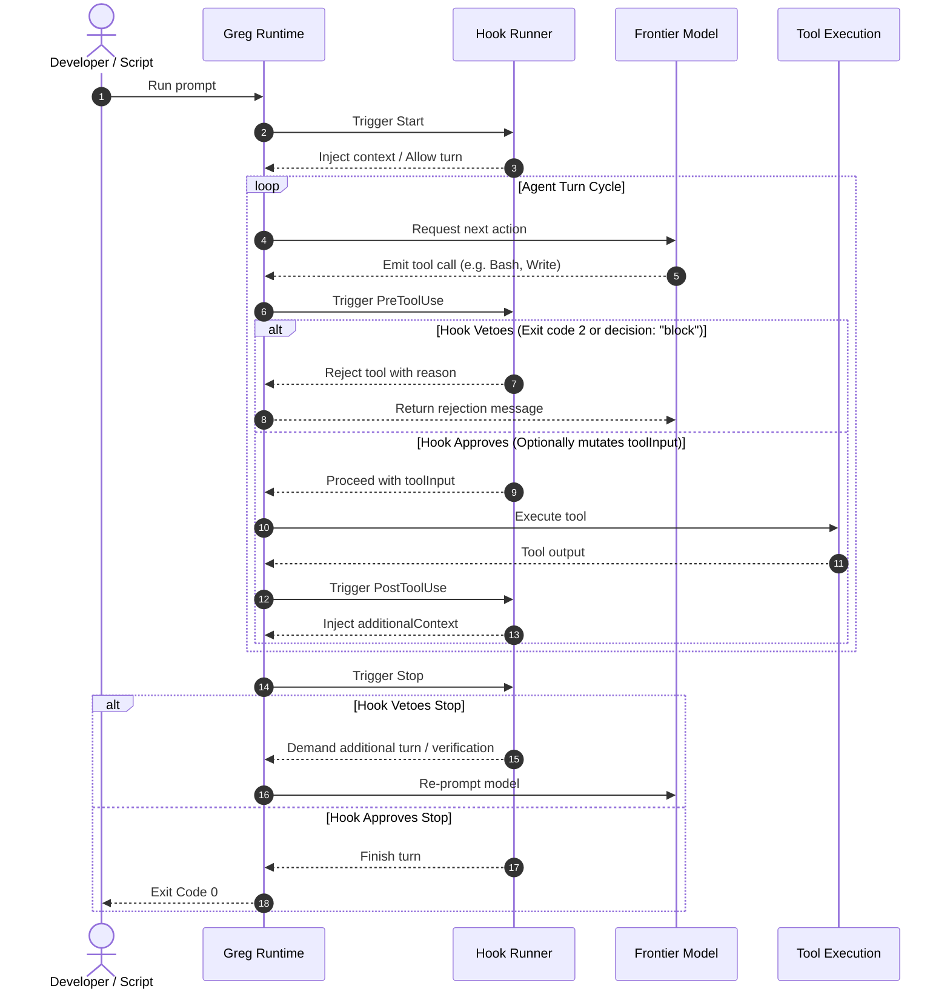

`greg` features a deterministic, event-driven **Lifecycle Hooks** system. Hooks allow developers and engineering teams to intercept agent actions, enforce repository security policies, inject domain context, run linters after file edits, mutate tool arguments, and verify turn completion using custom shell scripts or isolated LLM evaluators.

Hooks run automatically as part of the Hernex execution cycle, without requiring custom wrappers or modified agent loops.

<Note>
For the underlying architectural mechanics of how the Hernex engine processes hooks during turn cycles, see [How Greg Works](/how-greg-works). For general everyday terminal recipes, see [Common Workflows](/common-workflows).
</Note>

This page covers:

- [How Hooks Work](#how-hooks-work): Event lifecycle sequence and execution boundaries.
- [Lifecycle Events](#lifecycle-events): `PreToolUse`, `PostToolUse`, `Start`, and `Stop`.
- [Hook Execution Types](#hook-execution-types): Shell `command` hooks vs isolated LLM `prompt` hooks.
- [Configuration Files & Locations](#configuration-files-locations): Project `.greg/config/hooks.json` vs global `~/.greg/config/hooks.json`.
- [Subprocess Communication Protocol](#subprocess-communication-protocol): Input payloads, stdout controls, and exit code semantics (`0` vs `2`).
- [Tool Matchers & `if` Filter Rules](#tool-matchers-if-filter-rules): Scoping hooks by tool name and wildcard command/path patterns.
- [Real-World Recipes](#real-world-recipes): Practical examples for Git guardrails, formatting, prompt injection, and CI validation.
- [Disabling & Bypassing Hooks](#disabling-bypassing-hooks): Managing execution with `--bare`, `disableGlobalHooks`, and `disableAllHooks`.
- [Next Steps](#next-steps): Guided links to deeper topics.

---

## How Hooks Work

Hooks integrate directly into `greg`'s execution engine via Hernex's `AgentHooks` interface (`onBeforeTurn`, `onAuthorizeTool`, `onPostTool`, and `onShouldStop`).



### Core Design Guarantees

1. **Non-Blocking Warnings**: Unlike strict exit code protocols where any non-zero exit fails the process, `greg` treats generic non-zero exit codes (like `1` or `127`) as non-blocking warnings—logging diagnostics to `stderr` without crashing your agent turn. Only **exit code 2** or an explicit JSON `decision: "block"` halts execution.
2. **Process Group Isolation**: Every shell command hook executes in an isolated process group. When `greg` exits or a hook exceeds its timeout, child subprocesses and their descendants are forcefully terminated (`SIGKILL`), preventing runaway background tasks.
3. **No Context Pollution**: Prompt-based hooks evaluate constraints in an ephemeral in-memory microkernel using read-only tools (`ReadFile`, `Glob`, `Grep`). They never write to disk transcripts or pollute your primary session history.

---

## Lifecycle Events

`greg` fires four deterministic lifecycle events during agent turns:

| Event Name        | When It Triggers                                                                                               | What the Hook Can Do                                                                                                                                                                                                                                                                   |
| :---------------- | :------------------------------------------------------------------------------------------------------------- | :------------------------------------------------------------------------------------------------------------------------------------------------------------------------------------------------------------------------------------------------------------------------------------- |
| **`Start`**       | Fired immediately after the user provides a prompt, before the model receives it.                              | - Inject repository instructions or schema context via `additionalContext`.<br />- Rewrite the user prompt via `updatedPrompt` before the model sees it.<br />- Know whether this is a fresh run or resumed thread via `source`.<br />- Veto the prompt with a blocking error message. |
| **`PreToolUse`**  | Fired after the model requests a tool and policy permissions approve it, but _before_ disk or shell execution. | - Intercept dangerous operations (e.g. `git push`, `rm -rf`).<br />- Mutate tool input parameters via `updatedInput`.<br />- Veto tool execution.                                                                                                                                      |
| **`PostToolUse`** | Fired immediately after a tool finishes execution (success or error).                                          | - Run formatters (Prettier, Biome, rustfmt) on modified files.<br />- Inspect tool output and inject `additionalContext` for the model's next turn.                                                                                                                                    |
| **`Stop`**        | Fired when the agent decides it has completed the user's task and attempts to stop.                            | - Inspect the final response.<br />- Prevent stopping if verification tests or typechecks have not passed.                                                                                                                                                                             |

---

## Hook Execution Types

Hooks are declared using the `type` discriminator in `hooks.json`:

### 1. `command` Hooks (Shell Processes)

Spawns a local shell subprocess (`bash` on Linux/macOS or `powershell` on Windows). The process receives structured JSON on `stdin` and communicates decisions via exit codes or JSON on `stdout`.

```json
{
  "type": "command",
  "command": "./scripts/verify-safe-push.sh",
  "timeout": 30,
  "env": {
    "NODE_ENV": "development"
  }
}
```

- **`command`**: Executable string or script path.
- **`shell`**: Shell interpreter (`"bash"` or `"powershell"`, default: `"bash"`).
- **`timeout`**: Wall-clock timeout in seconds (default: 60s). Can also specify `timeoutMs`.
- **`statusMessage`**: Optional text displayed on `stderr` while the hook executes.
- **`once`**: When `true`, automatically unregisters after running once.
- **`env`**: Extra environment variables with `$VAR` and `${VAR}` interpolation.

### 2. `prompt` Hooks (Isolated LLM Evaluators)

Runs a fast, read-only AI evaluation model to verify safety, architecture, or functional correctness.

```json
{
  "type": "prompt",
  "prompt": "Evaluate this operation: $ARGUMENTS. Verify that no private encryption keys or secrets are written to disk.",
  "model": "google/gemini-3.8-flash",
  "fallbackModels": ["anthropic/claude-sonnet-4-6"],
  "timeout": 30
}
```

- **`prompt`**: Evaluation instruction. `$ARGUMENTS` is automatically replaced with the serialized `HookInput` JSON.
- **`appendSystemPrompt`**: Optional instructions appended to the base safety evaluator system prompt.
- **`model`**: Target model in `provider/modelId` format (defaults to the currently active runtime model).
- **`fallbackModels`**: Ordered fallback models attempted if the primary model fails.
- **`timeout`**: Timeout in seconds (default: 30s). Can also specify `timeoutMs`.

---

## Configuration Files & Locations

Hooks are declared in standard JSON configuration files:

```
~/.greg/config/hooks.json            # 1. Global Developer Hooks (applies to all projects)
<project-root>/.greg/config/hooks.json # 2. Project Hooks (committed to repository)
```

### Precedence & Scoping Rules

1. **Project Precedence**: Project-level hook matchers execute **before** global hook matchers.
2. **Project Isolation (`disableGlobalHooks`)**: To prevent developer-local global scripts from interfering with a shared project, add `"disableGlobalHooks": true` to your project's `.greg/config/hooks.json`.
3. **Master Kill Switch (`disableAllHooks`)**: Set `"disableAllHooks": true` to suspend all hook execution without deleting the file.

---

## Subprocess Communication Protocol

Command hooks communicate with `greg` over standard process boundaries:

```
           +-----------------------------------------------+
           |                  Greg Runtime                 |
           +-----------------------------------------------+
                               |       ^
            stdin (HookInput)  |       |  stdout (HookOutput)
                               v       |
           +-----------------------------------------------+
           |               Hook Subprocess                 |
           |             (Exit Code 0, 2, or 1)            |
           +-----------------------------------------------+
```

### Standard Input Payload (`HookInput`)

`greg` serializes a minimal JSON payload to the hook's `stdin`:

```json
{
  "sessionId": "7b2c6114-d89e-4906-9f99-0d3b81d92875",
  "hookEvent": "PreToolUse",
  "projectDir": "/home/user/project",
  "cwd": "/home/user/project",
  "model": "anthropic/claude-sonnet-4-6",
  "turnIndex": 1,
  "toolName": "Bash",
  "toolInput": {
    "command": "git push origin main"
  }
}
```

For `Start` events, the payload includes `source` and `userPrompt` instead of tool fields:

```json
{
  "sessionId": "7b2c6114-d89e-4906-9f99-0d3b81d92875",
  "hookEvent": "Start",
  "projectDir": "/home/user/project",
  "cwd": "/home/user/project",
  "model": "google/gemini-3.8-flash",
  "turnIndex": 1,
  "source": "startup",
  "userPrompt": "Fix the broken tests in src/hooks"
}
```

`source` is `"startup"` on Turn 1 of a brand-new thread; `"resume"` for resumed threads or any subsequent turn.

In addition to `stdin`, `greg` injects the following environment variables:

| Variable                | Description                         | Example                       |
| :---------------------- | :---------------------------------- | :---------------------------- |
| `GREG_PROJECT_DIR`      | Absolute path to project root       | `/home/user/project`          |
| `GREG_CWD`              | Active working directory            | `/home/user/project`          |
| `GREG_HOOK_EVENT`       | Active lifecycle event              | `PreToolUse`                  |
| `GREG_SESSION_ID`       | Safe thread identifier              | `7b2c6114-...`                |
| `GREG_TURN_INDEX`       | 1-based turn number                 | `1`                           |
| `GREG_MODEL`            | Active model identifier             | `anthropic/claude-sonnet-4-6` |
| `GREG_VERSION`          | Installed greg version              | `0.1.10`                      |
| `GREG_TOOL_NAME`        | Active tool name (if applicable)    | `Bash` or `Write`             |
| `GREG_TOOL_STATUS`      | Execution status (PostToolUse only) | `success` or `error`          |
| `GREG_TOOL_DURATION_MS` | Tool elapsed milliseconds           | `124`                         |

### Subprocess Exit Codes

The child process exit code dictates the runtime outcome:

- **Exit Code `0` (Success)**: Execution continues. The hook may optionally emit JSON on `stdout` to mutate inputs or inject context.
- **Exit Code `2` (Blocking Veto)**: Explicit veto protocol. Aborts the tool call or prevents turn completion immediately. Any text written to the hook's `stderr` is passed directly to the model as the blocking explanation.
- **Any Other Exit Code (e.g. `1`, `127`)**: Non-blocking warning. The operation is **not** aborted; the failure is logged to `stderr` and recorded in metrics.

### Standard Output Payload (`HookOutput`)

To mutate parameters or inject text, emit JSON on `stdout` with exit code 0:

```json
{
  "decision": "block",
  "reason": "Direct pushes to main branch are forbidden by engineering policy."
}
```

```json
{
  "updatedInput": {
    "command": "git push origin feature/my-safe-branch"
  },
  "additionalContext": "Note: Push target was automatically remapped to feature branch."
}
```

For `Start` hooks, emit `updatedPrompt` to rewrite the user's prompt before the model sees it:

```json
{
  "updatedPrompt": "PROJ-123: Add retry logic to src/utils/http.ts with 3 retries and exponential backoff.",
  "additionalContext": "Ticket expanded from short reference PROJ-123."
}
```

If `updatedPrompt` is an empty or whitespace-only string it is ignored and the original prompt is preserved.

---

## Tool Matchers & `if` Filter Rules

To prevent executing unnecessary subprocesses on every tool call, matchers and `if` filters narrow hook execution:

### 1. Tool Matchers (`matcher`)

Matched against the tool name (`Bash`, `Write`, `Edit`, `Read`, `Glob`, `Grep`, `Lsp`, `WebFetch`, `WebSearch`):

- `"*"` (or omitted): Matches all tools unconditionally.
- `"Bash"`: Matches only `Bash`.
- `"Write|Edit"`: Pipe-separated list matching either `Write` or `Edit`.
- `"^(Read|Glob)$"`: Regular expression matching.

### 2. Argument Filters (`if`)

The `if` property uses `greg`'s permission rule syntax to match tool targets:

```json
{
  "matcher": "Bash",
  "if": "Bash(git push *)"
}
```

```json
{
  "matcher": "Write|Edit",
  "if": "Write(src/auth/*)"
}
```

---

## Real-World Recipes

### Recipe 1: Block Dangerous Git Commands (`PreToolUse`)

Prevent the agent from accidentally force-pushing or modifying `main`:

Create `.greg/config/hooks.json`:

```json
{
  "hooks": {
    "PreToolUse": [
      {
        "matcher": "Bash",
        "if": "Bash(git push *)",
        "hooks": [
          {
            "type": "command",
            "command": "node -e 'const input = JSON.parse(require(\"fs\").readFileSync(0, \"utf-8\")); if (input.toolInput?.command?.includes(\"main\") || input.toolInput?.command?.includes(\"--force\")) { process.stderr.write(\"Force pushes or direct pushes to main are prohibited.\"); process.exit(2); }'",
            "statusMessage": "Verifying Git safety guardrails..."
          }
        ]
      }
    ]
  }
}
```

If `greg` attempts `git push origin main`, the process exits with code 2 and the model receives:

```text
Force pushes or direct pushes to main are prohibited.
```

---

### Recipe 2: Auto-Format Code After Edits (`PostToolUse`)

Automatically format files with Prettier or Biome whenever `Write` or `Edit` completes:

```json
{
  "hooks": {
    "PostToolUse": [
      {
        "matcher": "Write|Edit",
        "hooks": [
          {
            "type": "command",
            "command": "npx prettier --write \"$GREG_PROJECT_DIR/${toolInput.filePath}\" 2>/dev/null || true",
            "statusMessage": "Formatting modified file..."
          }
        ]
      }
    ]
  }
}
```

---

### Recipe 3: Inject Git Branch Context on Every Prompt (`Start`)

Automatically inject the current branch name as context before the model processes any prompt:

```json
{
  "hooks": {
    "Start": [
      {
        "hooks": [
          {
            "type": "command",
            "command": "echo \"{\\\"additionalContext\\\": \\\"Active branch: $(git rev-parse --abbrev-ref HEAD 2>/dev/null || echo unknown)\\\"}\"",
            "statusMessage": "Injecting git branch context..."
          }
        ]
      }
    ]
  }
}
```

---

### Recipe 4: Rewrite Prompt to Expand Ticket IDs (`Start`)

Expand ticket references like `PROJ-123` into full task descriptions before the model sees the prompt:

```json
{
  "hooks": {
    "Start": [
      {
        "hooks": [
          {
            "type": "command",
            "command": "./scripts/expand-ticket-id.sh",
            "statusMessage": "Expanding ticket references in prompt..."
          }
        ]
      }
    ]
  }
}
```

The script reads the `HookInput` JSON from `stdin`, looks up the ticket, and emits:

```json
{
  "updatedPrompt": "PROJ-123: Add retry logic to the HTTP client in src/utils/http.ts. Acceptance: 3 retries with exponential backoff."
}
```

---

### Recipe 5: Block Prompts on Startup if Environment Is Not Ready (`Start`)

Prevent agent runs from starting if required secrets or tooling are absent:

```json
{
  "hooks": {
    "Start": [
      {
        "hooks": [
          {
            "type": "command",
            "command": "[ -n \"$OPENAI_API_KEY\" ] || { echo 'OPENAI_API_KEY is not set. Export it before running greg.' >&2; exit 2; }",
            "statusMessage": "Verifying environment..."
          }
        ]
      }
    ]
  }
}
```

---

### Recipe 6: Enforce Verification Tests Before Stopping (`Stop`)

Prevent the agent from completing its turn until test suites pass:

```json
{
  "hooks": {
    "Stop": [
      {
        "hooks": [
          {
            "type": "command",
            "command": "bun test >/dev/null 2>&1 || { echo 'Cannot stop: unit tests are currently failing. Fix the failures before finishing.' >&2; exit 2; }",
            "statusMessage": "Running test suite before stopping..."
          }
        ]
      }
    ]
  }
}
```

If any test fails, the agent is prevented from stopping and receives the error message, automatically continuing to fix the broken assertions.

---

### Recipe 7: AI Security Screening Hook (`prompt`)

Screen proposed database migrations or file writes with a lightweight LLM prompt hook:

```json
{
  "hooks": {
    "PreToolUse": [
      {
        "matcher": "Write|Edit",
        "if": "Write(src/db/migrations/*)",
        "hooks": [
          {
            "type": "prompt",
            "prompt": "Evaluate this database migration proposal: $ARGUMENTS. Verify that no destructive table drops (DROP TABLE) without safety backups are being executed.",
            "model": "google/gemini-3.8-flash",
            "timeout": 20
          }
        ]
      }
    ]
  }
}
```

---

## Disabling & Bypassing Hooks

When troubleshooting, benchmarking, or running minimal scripts, you can control hook execution without modifying configuration files:

### 1. Bare Mode (`--bare`)

The `--bare` CLI flag completely disables hooks, ambient instruction files (`AGENTS.md`), and persistent configurations for a single execution:

```bash
greg "Quick inspection task" --bare
```

### 2. Project Isolation (`disableGlobalHooks`)

Add to `.greg/config/hooks.json` to prevent developer-local global scripts from firing in your repository:

```json
{
  "disableGlobalHooks": true,
  "hooks": { ... }
}
```

### 3. Kill-Switch (`disableAllHooks`)

Temporarily disable all hooks in a project or globally:

```json
{
  "disableAllHooks": true
}
```

---

## Next Steps

Now that you know how to build event-driven guardrails and automation scripts:

- [Common Workflows](/common-workflows): Explore real-world recipes for debugging, refactoring, and CI pipelines.
- [How Greg Works](/how-greg-works): Inspect the complete agent execution loop and fail-closed permission engine.
- [Managing Threads](/threads): Master session branching, checkpoints, and time-travel rollback workflows.
