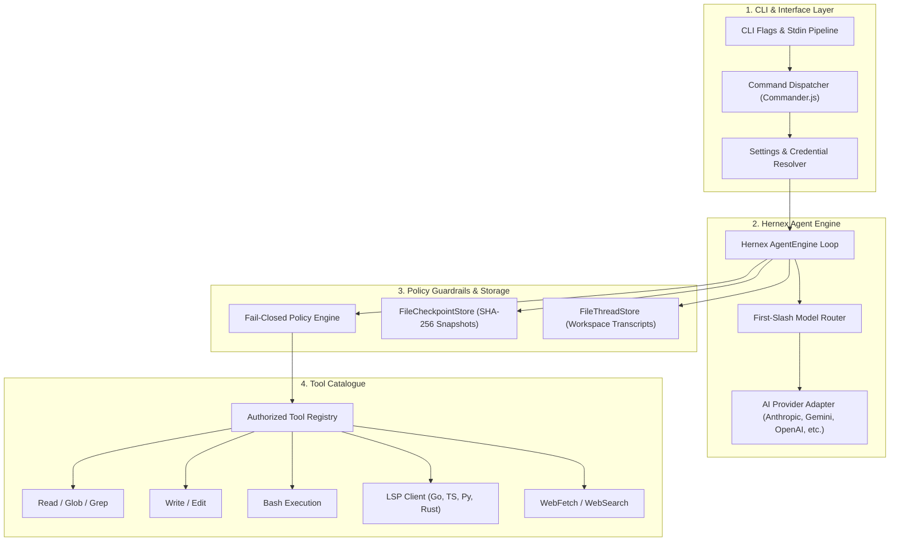
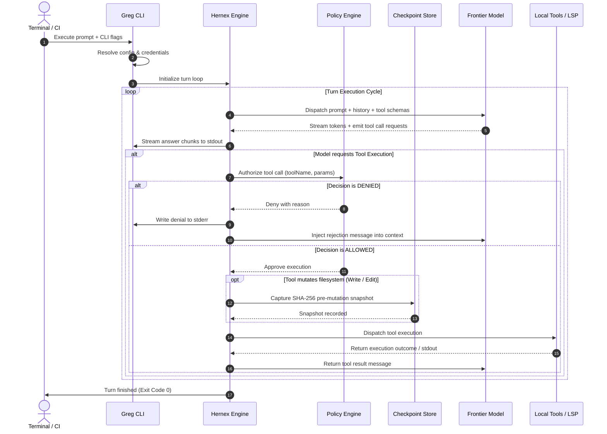
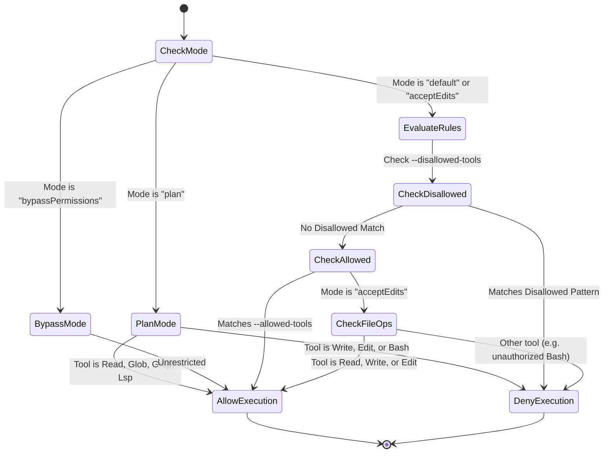
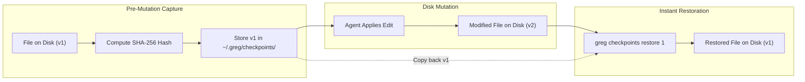

`greg` is designed from first principles as an autonomous **print agent**. While traditional AI coding tools operate as interactive terminal chat UIs that trap your workflow inside an endless conversational loop, `greg` treats the large language model as a composable Unix command-line utility.

Powered by the [@amaranthic/hernex](https://github.com/amaranthic/hernex) agent runtime, `greg` executes complex multi-step developer tasks, reads abstract syntax trees through language servers, manages deterministic security guardrails, snapshots pre-mutation file states, and streams clean results directly to standard output.

<Note>
Whether you are a software developer using `greg` for everyday refactoring or a platform engineer embedding `greg` into automated CI/CD pipelines, this document breaks down the underlying architecture, execution cycles, and safety mechanisms.
</Note>

This page covers:

- [High-Level System Architecture](#high-level-system-architecture): The 4-tier stack spanning CLI parsing, the Hernex engine, storage layers, and tools.
- [The Print Agent I/O Contract](#the-print-agent-io-contract): Stream separation, Unix piping, and clean `stdout` composability.
- [The Agent Execution Lifecycle](#the-agent-execution-lifecycle): Sequence diagram of turns, hooks, model invocations, and tool dispatches.
- [Deterministic Permission Engine](#deterministic-permission-engine): Fail-closed security, declarative permission modes, and wildcard policy matching.
- [Content-Addressed Delta Checkpoints](#content-addressed-delta-checkpoints): Pre-mutation SHA-256 snapshots and conflict-free rollbacks.
- [Persistent Workspace Threads](#persistent-workspace-threads): On-disk transcript persistence, workspace isolation, and turn time travel.
- [Native Language Server Protocol (LSP)](#native-language-server-protocol-lsp): AST symbol navigation and compiler-grade type analysis.
- [POSIX Process Exit Codes](#posix-process-exit-codes): Deterministic exit code contracts for shell and CI scripting.
- [Next Steps](#next-steps): Guided links to deeper guides.

---

## High-Level System Architecture

`greg` is structured into four decoupled layers, ensuring that CLI flag resolution, engine orchestration, security enforcement, and filesystem operations remain strictly isolated:



### The 4 Architectural Tiers

| Tier                    | Component                  | Responsibility                                                                                                    |
| :---------------------- | :------------------------- | :---------------------------------------------------------------------------------------------------------------- |
| **1. CLI & Interface**  | `src/cli/` & `src/output/` | Argument parsing, reading piped `stdin`, stream multiplexing (`stdout` vs `stderr`), and ANSI formatting.         |
| **2. Engine Runtime**   | `@amaranthic/hernex`       | Multi-turn reasoning loops, streaming token decoders, model fallbacks, and lifecycle hook orchestration.          |
| **3. Policy & Storage** | `src/policy/` & `~/.greg/` | Deterministic fail-closed authorization, wildcard pattern compilation, delta checkpoints, and thread persistence. |
| **4. Tool Catalogue**   | `ToolRegistry`             | Real-world capabilities: filesystem mutations, shell execution, AST compiler queries via LSP, and web fetching.   |

---

## The Print Agent I/O Contract

The central design philosophy of `greg` is strict **stream isolation**. In standard terminal programming, mixing interactive diagnostic messages with output data makes piping to tools like `jq`, `sed`, or clipboard utilities impossible without noisy scraping.

`greg` enforces a clean I/O separation:

```
                   +------------------+
  stdin (pipes)    |                  |   stdout (clean Markdown/code)
------------------>|      greg        |-------------------------------->
                   |   Print Agent    |
                   |                  |   stderr (diagnostics & telemetry)
                   +------------------+-------------------------------->
```

### 1. Standard Input (`stdin`)

When data is piped into `greg` (e.g. `cat error.log | greg "Diagnose this"`), the CLI automatically buffers standard input up to 512 KiB (`maxStdinBufferBytes`), injects it into the initial prompt context, and executes without waiting for keyboard interaction.

### 2. Standard Output (`stdout`)

Standard output is reserved exclusively for the model's final response text, generated source code, or structured JSON (when `--output-format json` or `--output-format stream-json` is requested). Output redirection (`greg "..." > file.ts`) produces completely clean files without terminal control characters.

### 3. Standard Error (`stderr`)

All runtime telemetry—turn counters, token metrics, tool call notices (e.g. `Read(src/index.ts)`), LSP status, and permission denials—are routed strictly to standard error.

---

## The Agent Execution Lifecycle

When you trigger a command such as `greg "Fix unit tests" --permission-mode acceptEdits`, the execution loop proceeds through a deterministic sequence:



### The Turn Step Breakdown

1. **Ambient Configuration Ingestion**: Resolves project-level `.greg/settings.json`, environment variables, and CLI overrides.
2. **Session Thread Hydration**: Reads persistent history from `~/.greg/threads/<id>.json`. If `-c` is passed, loads the latest workspace session.
3. **Model Request Dispatch**: Connects to the target model provider via Hernex's first-slash routing adapter, attaching JSON schemas for authorized tools.
4. **Streaming & Tool Interception**: Model tokens stream to `stdout` in real time. If the model emits structured tool calls, execution pauses for authorization.
5. **Fail-Closed Policy Check**: Every tool call is evaluated against the active permission mode and wildcard allow/deny rules.
6. **Pre-Mutation Checkpointing**: If a tool will modify or create a file, `FileCheckpointStore` records the exact file content and SHA-256 hash before disk writes occur.
7. **Tool Execution & Feedback**: The tool runs, captures output/errors, and feeds results back to the model for subsequent turns until the agent finishes.

---

## Deterministic Permission Engine

Security in `greg` is **fail-closed**: any tool call that is not explicitly authorized is immediately denied. In non-interactive print mode, `greg` never blocks on keyboard confirmation prompts—unauthorized actions fail fast.



### The 4 Permission Modes

| Permission Mode     | Read Tools (`Read`, `Glob`, `Grep`, `Lsp`) | File Mutations (`Write`, `Edit`) | Shell Execution (`Bash`)           | Primary Use Case                                     |
| :------------------ | :----------------------------------------- | :------------------------------- | :--------------------------------- | :--------------------------------------------------- |
| `default`           | Allowed                                    | Denied                           | Denied (unless explicitly allowed) | Safe codebase exploration and analysis.              |
| `acceptEdits`       | Allowed                                    | Allowed                          | Denied (unless explicitly allowed) | Autonomous code writing, bug fixes, and refactoring. |
| `plan`              | Allowed                                    | Hidden                           | Hidden                             | Architectural reconnaissance before disk changes.    |
| `bypassPermissions` | Allowed                                    | Allowed                          | Allowed                            | Trusted CI/CD runners or isolated containers.        |

### Wildcard Scoped Allow Rules

You can grant granular execution rights to specific shell commands or file paths using PascalCase tool rules:

```bash
# Allow file edits AND running bun test, but deny any other shell command
greg "Fix failing tests" \
  --permission-mode acceptEdits \
  --allowed-tools "Bash(bun test *)"

# Restrict file mutations to a specific directory
greg "Update docs" \
  --allowed-tools "Write(docs/*)" "Edit(docs/*)"
```

Rules are compiled into anchored regular expressions (`src/policy/ruleMatch.ts`), supporting wildcard glob expansion (`*`), escaped characters, and argument boundaries.

---

## Content-Addressed Delta Checkpoints

Unlike tools that rely on Git commits (polluting your commit history with intermediate agent attempts), `greg` maintains an out-of-band content-addressed store powered by Hernex's `FileCheckpointStore`.



### Checkpoint Guarantees

1. **Pre-Mutation Atomicity**: Checkpoints record file states _before_ mutations occur. If a tool writes 5 files and crashes on the 6th, the pre-mutation state of all 6 files is preserved.
2. **Content-Addressed Blob Deduplication**: Rather than creating duplicate copies of entire repositories, Hernex stores unique file contents in a global content-addressed store at `~/.greg/blobs/sha256/<hash>`. Multiple checkpoints referencing the same file content share identical blob entries.
3. **Thread-Scoped Manifests**: Each thread maintains its own manifest at `~/.greg/threads/<id>/checkpoints/manifest.json` using a version 2 envelope (`{ version: 2, checkpoints: [...] }`), tracking sequence numbers, UUIDs, labels, turn indices, and SHA-256 pre/post state hashes.
4. **External Conflict Detection**: When restoring with `greg checkpoints restore <id>`, `greg` compares current disk hashes against post-mutation states. If you modified files externally, restoration halts to prevent accidental overwrites unless `--force` is passed.
5. **Dry-Run Inspection**: You can preview what files will be restored, deleted, or conflicted before touching disk using `--dry-run`:
   ```bash
   greg checkpoints restore 1 --dry-run
   ```

---

## Persistent Workspace Threads

`greg` persists conversation sessions under `~/.greg/threads/<thread-id>/` (or `$HERNEX_HOME/threads/<thread-id>/`). Sessions are automatically partitioned by your current working directory (`process.cwd()`).

### On-Disk Thread Layout

Inside each thread directory, `FileThreadStore` maintains three core files:

```
~/.greg/
├── threads/
│   └── <thread-id>/
│       ├── thread.json              # Metadata: title, workingDirectory, model, turnCount, status
│       ├── transcript.jsonl         # Append-only JSONL log: user prompts, model messages, tool events
│       └── checkpoints/
│           └── manifest.json        # Manifest tracking recorded pre-mutation snapshots for this thread
├── blobs/
│   └── sha256/
│       └── <hash>                   # Global content-addressed snapshot blobs
└── locks/
    └── threads/
        └── <thread-id>.lock         # Advisory file locks preventing concurrent turn corruption
```

### Session Lifecycle & Time Travel

```
Turn 1: "Add User schema in src/models.ts"          [Checkpoint #1 Recorded]
   |
Turn 2: "Add validation helper in src/utils.ts"    [Checkpoint #2 Recorded]
   |
Turn 3: "Add unit tests in tests/user.test.ts"     [Checkpoint #3 Recorded]
   |
   +---> Branch with --resume-session-at 2:
         "Let's switch from Zod to Valibot instead" (Discards Turn 3 context)
```

- **Continuing Tasks (`-c`)**: Reads the most recently updated thread for the current directory and appends the new instruction.
- **1-Based Turn Indexing (`--resume-session-at <index>`)**: Truncates the active conversation to the exact turn count specified, allowing you to branch or explore alternate architectures without polluting model context.

---

## Native Language Server Protocol (LSP)

Plain text regex search (`grep`) is fast, but struggles with multi-file renames, ambiguous symbol names, and type definitions. `greg` embeds a native **LSP Client** powered by Hernex's `LspTool` and persistent `LspProcessPool`.

### Enabling LSP Code Intelligence

By default, `enableLsp` is set to `false` in settings to ensure instant startup for general-purpose text tasks. To enable LSP code intelligence globally:

```bash
greg config set enableLsp true
```

When enabled, `greg` automatically checks your registered servers or falls back to its curated default catalog in `src/utils/lsp.ts`.

### Curated Default Server Catalog

| Language            | Server Identifier | Command & Args                        | Handled Extensions                           |
| :------------------ | :---------------- | :------------------------------------ | :------------------------------------------- |
| **TypeScript / JS** | `typescript`      | `typescript-language-server --stdio`  | `.ts`, `.tsx`, `.js`, `.jsx`, `.mjs`, `.cjs` |
| **Python**          | `python`          | `pyright-langserver --stdio`          | `.py`, `.pyi`                                |
| **Go**              | `go`              | `gopls`                               | `.go`                                        |
| **Rust**            | `rust`            | `rust-analyzer`                       | `.rs`                                        |
| **CSS**             | `css`             | `vscode-css-language-server --stdio`  | `.css`, `.scss`, `.less`                     |
| **HTML**            | `html`            | `vscode-html-language-server --stdio` | `.html`, `.htm`                              |
| **JSON**            | `json`            | `vscode-json-language-server --stdio` | `.json`, `.jsonc`                            |

### Supported LSP Operations

Hernex exposes compiler-grade operations conforming to `lspInputSchema`:

| Operation            | Parameters                      | Description                                                           |
| :------------------- | :------------------------------ | :-------------------------------------------------------------------- |
| `goToDefinition`     | `filePath`, `line`, `character` | Resolves target declaration or interface definition coordinates.      |
| `goToImplementation` | `filePath`, `line`, `character` | Finds concrete class or interface implementations.                    |
| `findReferences`     | `filePath`, `line`, `character` | Discovers all usages of a symbol across the workspace.                |
| `hover`              | `filePath`, `line`, `character` | Retrieves type signature, documentation, and hover cards.             |
| `documentSymbol`     | `filePath`                      | Lists all classes, methods, and functions in a file.                  |
| `workspaceSymbol`    | `filePath`, `query`             | Searches for symbols matching a query string across the project.      |
| `diagnostics`        | `filePath`                      | Fetches active compiler warnings, syntax errors, and type mismatches. |

_Note: Line and character parameters use 1-based indexing._

### Managing Language Servers (`greg lsp`)

You can register custom language servers (e.g. `gopls`, `clangd`, `zls`, or `solc`) using the `greg lsp` subcommand tree:

```bash
# List all active language servers
greg lsp list

# Register a custom language server
greg lsp add gopls --command gopls --extensions .go

# Temporarily disable LSP overhead for a quick prompt
greg "List functions in src/format.ts" --disable-lsp
```

---

## POSIX Process Exit Codes

For automation and CI/CD pipelines, `greg` adheres to standard POSIX process exit contracts. Shell scripts can inspect `$?` to branch deterministically:

| Exit Code | Constant           | Meaning                                                                 | Shell Handling Recommendation                           |
| :-------: | :----------------- | :---------------------------------------------------------------------- | :------------------------------------------------------ |
|  **`0`**  | `success`          | Agent execution completed successfully.                                 | Proceed to subsequent pipeline stages.                  |
|  **`1`**  | `runtimeError`     | Runtime exception, model failure, or uncaught error.                    | Inspect standard error log and fail build.              |
|  **`2`**  | `permissionDenied` | Operation aborted because a tool was denied under fail-closed security. | Check `--permission-mode` or `--allowed-tools`.         |
|  **`4`**  | `timeout`          | Wall-clock execution exceeded the configured `--timeout`.               | Retry with higher timeout or increase reasoning budget. |

---

## Next Steps

Now that you have a comprehensive understanding of `greg`'s internal mechanics:

- [Quickstart](/quickstart): Walk through your first practical task from start to finish.
- [Managing Providers](/model-providers): Configure frontier models, reasoning effort, and fallback chains.
- [Managing Threads](/threads): Master session branching, checkpoints, and time-travel rollbacks.
- [Common Workflows](/common-workflows): Explore real-world recipes for exploration, refactoring, and test automation.
