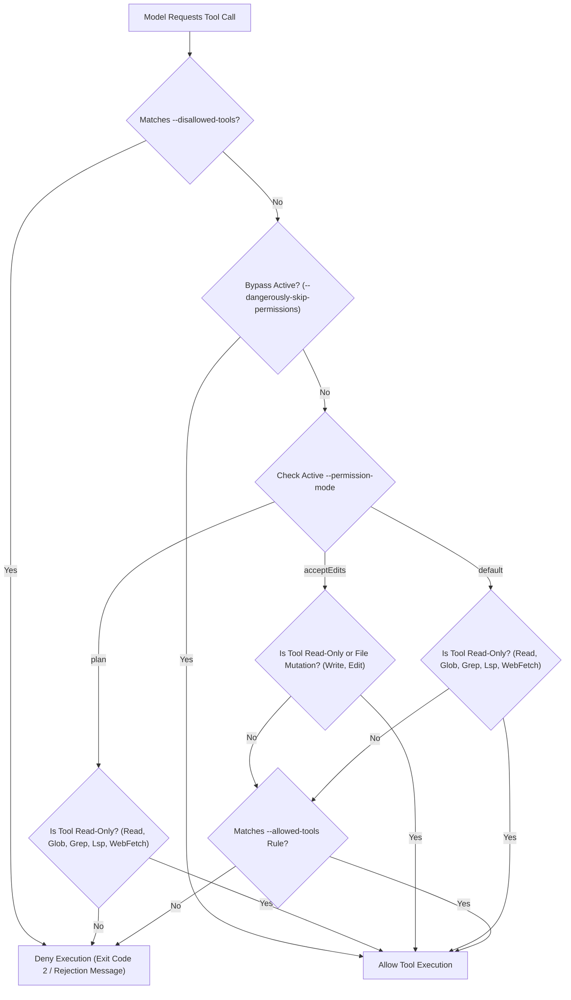

`greg` is designed from the ground up with a **fail-closed security architecture**. Because `greg` operates as an autonomous print agent in non-interactive terminals, scripts, and CI environments, it cannot pause execution to ask for human confirmation on every tool call.

Instead, `greg` relies on deterministic, pre-execution authorization policies. If an operation is not explicitly authorized by your active permission mode or allowed tool rules, it is immediately denied.

<Note>
For the underlying architectural mechanics of how the policy guardrail integrates into the Hernex engine loop, see [How Greg Works](/how-greg-works). For lifecycle event interceptors, see [Lifecycle Hooks](/hooks).
</Note>

This page covers:

- [The Fail-Closed Security Model](#the-fail-closed-security-model): Why non-interactive autonomous agents must fail closed.
- [Declarative Permission Modes](#declarative-permission-modes): Comparing `default`, `acceptEdits`, `plan`, and `bypassPermissions`.
- [Wildcard Scoped Tool Rules](#wildcard-scoped-tool-rules): Syntax, target normalization, and compilation for `Tool(pattern)`.
- [Denial Precedence](#denial-precedence): Why `--disallowed-tools` strictly overrules allow rules.
- [TaskManager & Shell Coupling](#taskmanager-shell-coupling): Why background processes require explicit Bash authorization.
- [Configuring Permissions](#configuring-permissions): Applying rules via CLI flags and persistent `settings.json`.
- [Security Best Practices](#security-best-practices): Hardening configurations for local machines, CI runners, and shared environments.
- [Next Steps](#next-steps): Guided links to deeper guides.

---

## The Fail-Closed Security Model

In interactive terminal chat UIs, when an agent wants to run a shell command or edit a file, it presents a prompt: `Allow Bash("rm -rf tmp")? [y/N]`. While this works for casual interactive use, it breaks down in automated pipelines, cron jobs, and terminal pipes.

`greg` eliminates interactive prompts in favor of **deterministic pre-execution evaluation**:



1. **Deterministic Evaluation**: Every tool call is evaluated against compiled wildcard regular expressions before touching disk or spawning child processes.
2. **Contextual Rejection Feedback**: When an action is denied, `greg` injects a structured denial reason into the model's message history. The model understands _why_ it was blocked and can adjust its strategy without crashing the run.
3. **Audit Trail**: Every denial is recorded in run metrics and logged to `stderr`.

---

## Declarative Permission Modes

`greg` provides four built-in permission modes specified via `--permission-mode <mode>`:

| Mode                    | Read Tools (`Read`, `Glob`, `Grep`, `Lsp`, `WebFetch`) | File Mutations (`Write`, `Edit`) | Shell Execution (`Bash`) | Description                                                                                                          |
| :---------------------- | :----------------------------------------------------- | :------------------------------- | :----------------------- | :------------------------------------------------------------------------------------------------------------------- |
| **`default`**           | **Allowed**                                            | Denied                           | Denied                   | **Strict read-only analysis.** Ideal for codebase exploration, code reviews, and answering architecture queries.     |
| **`acceptEdits`**       | **Allowed**                                            | **Allowed**                      | Denied                   | **Safe autonomous coding.** Allows file creation and edits, but blocks arbitrary shell commands unless authorized.   |
| **`plan`**              | **Allowed**                                            | _Hidden_                         | _Hidden_                 | **Reconnaissance mode.** Mutation and shell tools are completely removed from model schemas before invocation.       |
| **`bypassPermissions`** | **Allowed**                                            | **Allowed**                      | **Allowed**              | **Unrestricted execution.** Completely bypasses authorization checks. Intended for trusted CI runners or containers. |

---

### 1. `default` Mode (Read-Only)

The default mode when no flag is passed. The model can inspect your codebase using `Read`, `Glob`, `Grep`, `Lsp`, `WebFetch`, and `WebSearch`, but cannot write files or execute shell commands:

```bash
greg "Audit our API endpoints for missing authentication middleware"
```

If the model attempts to edit a file, `greg` rejects the call:

```text
Permission denied: Workspace mutation "writeFile(src/routes.ts)" not allowed in mode default.
Allow with --allowed-tools 'Write(src/routes.ts)' or --permission-mode acceptEdits.
```

---

### 2. `acceptEdits` Mode (File Mutations)

Authorizes `greg` to create, write, and edit files while continuing to block arbitrary shell commands:

```bash
greg "Refactor all callback usages in src/utils/fs.ts to async/await" \
  --permission-mode acceptEdits
```

Every file edit made under `acceptEdits` is automatically snapshotted in content-addressed storage before writing, allowing instant undo with `greg checkpoints restore 1`.

---

### 3. `plan` Mode (Reconnaissance)

In `plan` mode, `Write`, `Edit`, and `Bash` are completely filtered out of the model's available tools (`planModeToolNames`). The model cannot even attempt mutations; it can only formulate implementation plans:

```bash
greg "Formulate a step-by-step migration plan from Jest to Vitest" \
  --permission-mode plan
```

---

### 4. `bypassPermissions` Mode (Unrestricted)

Disables all permission checks. File edits and shell commands run without restrictions:

```bash
greg "Run linter, fix issues, and commit changes" \
  --permission-mode bypassPermissions
```

You can also pass `--dangerously-skip-permissions` as a standalone flag in any command:

```bash
greg "Run migrations" --dangerously-skip-permissions
```

<Note>
Use `bypassPermissions` and `--dangerously-skip-permissions` exclusively in sandboxed environments, ephemeral Docker containers, or trusted CI/CD pipelines.
</Note>

---

## Wildcard Scoped Tool Rules

To grant granular permissions without opening unrestricted shell access, use **Scoped Tool Rules** with `--allowed-tools`:

```bash
greg "Fix the failing tests in tests/auth.test.ts" \
  --permission-mode acceptEdits \
  --allowed-tools "Bash(bun test *)"
```

### Rule Syntax: `Tool(pattern)`

Tool rules use PascalCase tool names followed by parentheses containing a matching target:

```text
[ToolName]([Pattern])
```

| Tool Name       | Target Parameter Evaluated         | Example Rule                         | Meaning                                               |
| :-------------- | :--------------------------------- | :----------------------------------- | :---------------------------------------------------- |
| **`Bash`**      | `command` string                   | `Bash(bun test *)`                   | Allows any `bun test` command with any arguments.     |
| **`Bash`**      | `command` string                   | `Bash(git diff *)`                   | Allows read-only git diff commands.                   |
| **`Write`**     | `filePath` (relative to workspace) | `Write(src/services/*)`              | Allows writing files strictly inside `src/services/`. |
| **`Edit`**      | `filePath` (relative to workspace) | `Edit(tests/**/*.ts)`                | Allows editing TypeScript files in `tests/`.          |
| **`Read`**      | `filePath` (relative to workspace) | `Read(docs/*)`                       | Restricts reads to `docs/`.                           |
| **`WebFetch`**  | `url` string                       | `WebFetch(https://api.github.com/*)` | Allows fetching from GitHub's API domain only.        |
| **`WebSearch`** | `query` string                     | `WebSearch(typescript *)`            | Allows web searches starting with "typescript".       |

### How Target Matching Operates

1. **Path Normalization**: File paths passed to `Write`, `Edit`, or `Read` are resolved against `process.cwd()`, normalized to relative forward-slash paths (`src/utils/math.ts`), preventing directory traversal (`../../etc/passwd`) escapes.
2. **Wildcard Glob Expansion (`*`)**: The `*` token matches zero or more non-separator characters, or across subdirectories depending on context.
3. **Escaping**: To match a literal asterisk or backslash, escape it with `\*` or `\\`.
4. **Anchored Boundaries**: Patterns are compiled into full-string anchored regular expressions (`^...$`), ensuring that `Bash(git status)` only matches `git status`, not `git status && rm -rf /`.

---

## Denial Precedence

Security rules in `greg` strictly prioritize safety: **Disallow rules always win over allow rules**.

When `--disallowed-tools` is specified, any tool invocation matching a disallowed rule is denied immediately, even if it matches an `--allowed-tools` rule or the active `--permission-mode`:

```bash
# Authorize general shell commands, but strictly forbid rm and git push
greg "Clean build artifacts and run test suite" \
  --permission-mode acceptEdits \
  --allowed-tools "Bash(*)" \
  --disallowed-tools "Bash(rm *)" "Bash(git push *)"
```

If the agent attempts to run `rm -rf dist`, execution is rejected:

```text
Permission denied: Tool execution "Bash(rm -rf dist)" explicitly blocked by disallowedTools rule "Bash(rm *)".
```

---

## TaskManager & Shell Coupling

`greg` includes a background task manager powered by Hernex's `TaskManagerTool`. Background tasks spawn asynchronous sub-processes (such as starting a local development server or running a long test suite).

To maintain strict security boundaries, **`TaskManager` is directly coupled to `Bash` authorization**:

- `TaskManager` cannot be authorized independently.
- In `default` or `acceptEdits` mode, background tasks are permitted only if `Bash` is explicitly allowed (e.g. `--allowed-tools "Bash(*)"`).
- If `Bash` is denied, any attempt to spawn background tasks fails closed.

---

## Configuring Permissions

You can apply permission rules dynamically per command or persist them globally for your project:

### 1. Per-Command CLI Flags

```bash
# Allow file modifications and specific test command
greg "Task" \
  --permission-mode acceptEdits \
  --allowed-tools "Bash(npm test)" "Write(src/*)" \
  --disallowed-tools "Bash(git push *)"
```

### 2. Persistent Project Settings (`.greg/settings.json`)

To avoid typing permission flags on every command, persist rules in your project configuration:

```bash
# Set default permission mode
greg config set permissionMode acceptEdits

# Add permanent allow rules
greg config add allowedTools "Bash(bun test *)"
greg config add allowedTools "Bash(bun run lint)"

# Add permanent disallow rules
greg config add disallowedTools "Bash(rm -rf *)"
greg config add disallowedTools "Bash(git push * main*)"
```

View active permissions:

```bash
greg config get allowedTools
```

---

## Security Best Practices

### 1. Principle of Least Privilege

Always start with `default` (read-only) or `acceptEdits` mode. Only authorize the specific shell commands needed for verification (e.g. `Bash(npm test)` or `Bash(cargo check)`).

### 2. Guard Sensitive Branches in Git

Never allow unrestrained `git push` in shared environments. Disallow pushes to production branches:

```bash
greg config add disallowedTools "Bash(git push * main*)"
greg config add disallowedTools "Bash(git push * master*)"
```

### 3. Combine Permissions with Lifecycle Hooks

For multi-layer security, combine `--disallowed-tools` with a `PreToolUse` lifecycle hook that inspects argument payloads before execution. See [Lifecycle Hooks](/hooks).

### 4. Rely on Checkpoints for Recovery

If an authorized file edit introduces unwanted changes, use `greg checkpoints restore 1` to instantly revert the workspace back to its pre-mutation state.

---

## Next Steps

Now that you understand permission evaluation and security rules:

- [Common Workflows](/common-workflows): Explore real-world developer recipes with scoped permissions.
- [Lifecycle Hooks](/hooks): Learn how to build custom pre-execution shell guardrails.
- [How Greg Works](/how-greg-works): Inspect the complete agent execution cycle and engine architecture.
